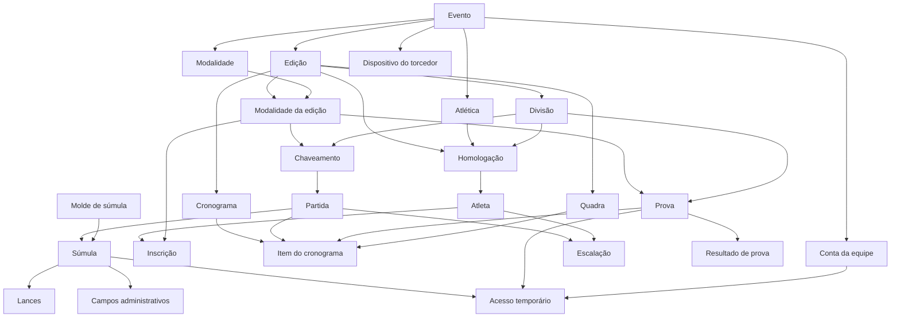
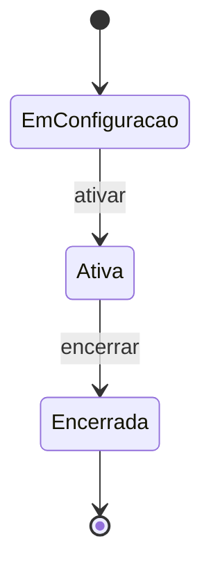
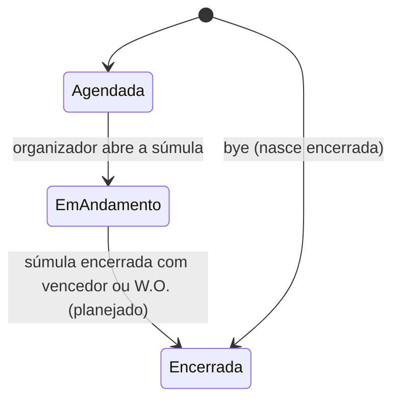
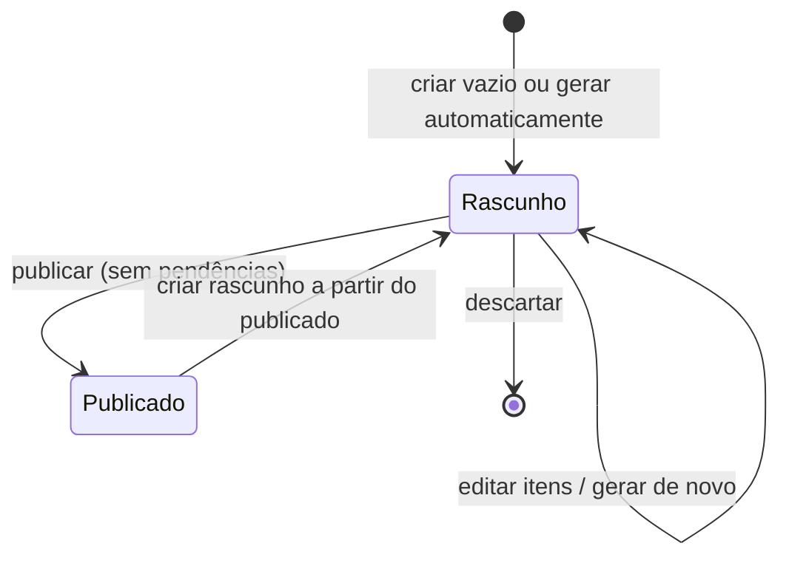
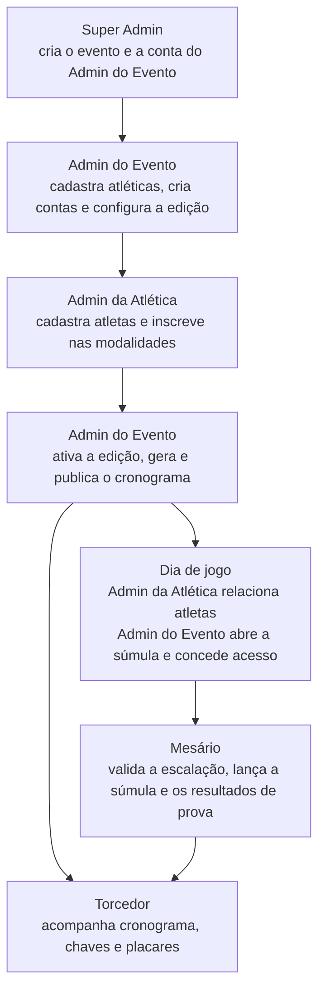

# CIA — Circuito Inter-Atléticas

**Documento único do produto e do sistema (fonte da verdade)**

| Item | Valor |
|---|---|
| Versão | 1.3.0 |
| Data | 16/10/2026 |
| Base | Repositório `c18-api`, branch `develop`, commit `a88d745` (16/10/2026) |
| Substitui | Documento de Visão, Modelo de Negócio, Requisitos, Casos de Uso, Diagrama de Classes e Modelagem de Banco (pasta `docs_md`), que ficaram desatualizados |
| Para quem | Time de desenvolvimento, design e agentes de IA que precisam do contexto completo do sistema |

> **Precedência das fontes.** (1) Código da API na `develop`. (2) Planos e regras do repositório (`docs/plans`, `docs/rules`). (3) Documentos antigos, usados só para o que ainda não existe na API, sempre com selo. Quando o código e um documento discordam, vale o código, salvo decisão explícita registrada na seção 12.

### Selos de status

| Selo | Significado |
|---|---|
| ✅ Pronto | Está na `develop`, com rota, regras e testes. |
| 🚧 Em desenvolvimento | Código em branch/PR aberto, ou plano detalhado no repositório pronto para implementar. |
| 📝 Planejado | Existe tabela no banco e/ou item no roadmap, mas sem código nem plano detalhado. |
| 💡 Visão | Só aparece nos documentos antigos; nada no repositório. Precisa de decisão antes de virar trabalho. |
| ⛔ Fora do MVP | Fica para depois do MVP. |

### Como usar este documento

- **Agente de IA:** leia as seções 1 a 8 para entender o domínio e as regras; a seção 10 traz a referência técnica. Para escrever código no repositório, siga também o `AGENTS.md` e os arquivos de `docs/rules/` (eles mandam sobre estilo e arquitetura).
- **Design:** as seções 1, 3, 5, 6 e 9 dão o contexto. A seção 9 só divide o que cada perfil tem; quais telas existem, o que cada uma mostra, o layout e a navegação são decisão do design.
- **Time:** a seção 11 diz o que está pronto, o que está em andamento e as pendências conhecidas.

---

## Sumário

1. [O produto](#1-o-produto)
2. [Glossário](#2-glossário)
3. [Atores e permissões](#3-atores-e-permissões)
4. [Modelo de domínio](#4-modelo-de-domínio)
5. [Ciclos de vida](#5-ciclos-de-vida)
6. [Jornada e fluxos](#6-jornada-e-fluxos)
7. [Funcionalidades e regras por módulo](#7-funcionalidades-e-regras-por-módulo)
8. [Regras transversais](#8-regras-transversais)
9. [O que cada perfil tem](#9-o-que-cada-perfil-tem)
10. [Referência técnica](#10-referência-técnica)
11. [Estado atual, roadmap e pendências](#11-estado-atual-roadmap-e-pendências)
12. [Decisões e divergências com os documentos antigos](#12-decisões-e-divergências-com-os-documentos-antigos)
13. [Histórico de versões](#13-histórico-de-versões)

---

## 1. O produto

### 1.1 O que é

O **CIA (Circuito Inter-Atléticas)** é uma plataforma *white-label* para organizar campeonatos esportivos universitários disputados entre **atléticas** (copas, circuitos e jogos inter-atléticas). Uma única instalação atende vários **eventos**; cada evento realiza **edições** (normalmente uma por ano), e cada edição tem sua própria identidade visual, divisões, modalidades, atléticas participantes, chaveamentos, cronograma e súmulas.

A plataforma cobre o campeonato de ponta a ponta: configuração da edição, inscrição de atletas pelas atléticas, geração automática de chaveamentos e cronograma, súmula digital em tempo real e acompanhamento pelo torcedor.

### 1.2 Problema

A organização desses eventos ainda é manual: o cronograma leva dias para montar e precisa ser refeito a cada imprevisto; súmulas, inscrições e listas de presença ficam em papel; as informações se espalham por WhatsApp, planilhas, stories e e-mails. Sem fonte única, a divulgação de resultados e próximos jogos é incompleta, os atletas descobrem o horário do jogo em cima da hora, não há controle confiável de quem entra em quadra e cada edição termina sem dados consolidados.

### 1.3 Proposta de valor

| Público | O que ganha |
|---|---|
| Organizadores | Painel único para configurar a edição, homologar atléticas, gerar chaveamento, provas e cronograma automaticamente, escalar mesários e acompanhar tudo em tempo real. Fim da montagem manual do cronograma. |
| Atléticas | Autonomia para cadastrar seus atletas e inscrevê-los nas modalidades, ver se já estão elegíveis em cada modalidade e montar a escalação das partidas. |
| Mesários | Súmula digital simples, com escalação, lançamentos ao vivo e tolerância a queda de conexão. |
| Atletas | Aparecem nas escalações, resultados e estatísticas a partir dos dados oficiais da súmula, sem precisar de conta. |
| Torcedores | Acompanham cronograma, chaves, placares e resultados da atlética de coração sem cadastro, e participam do Torcidômetro. |

### 1.4 Plataformas

| Plataforma | Quem usa | Observações |
|---|---|---|
| **Painel web** | Super Admin, Admin do Evento, Admin da Atlética | Toda a gestão do evento e da edição. |
| **Súmula digital** | Mesário (e organizadores, que também podem operar) | Roda **dentro do painel web**, com layout responsivo para celular e tablet. O front mantém uma fila offline: cada lançamento recebe um id gerado no cliente e é reenviado ao reconectar sem duplicar. |
| **App iOS do torcedor** | Torcedor | Um app por evento (white-label). Sem cadastro nem login: o torcedor é identificado pelo dispositivo. A identidade visual (foto e cores) vem da edição. |
| **API REST (`c18-api`)** | Todos os clientes acima | Node.js, Express, Prisma e PostgreSQL, em `/api/v1`. |

### 1.5 Escopo do MVP

**Dentro do MVP:** multi-evento com isolamento de dados; atualização em tempo real no painel e no app; contas da equipe por papel; configuração da edição (divisões, modalidades, quadras, atléticas homologadas); atletas e inscrições; chaveamento mata-mata e provas classificatórias; cronograma automático com rascunho e publicação; súmula digital com escalação, lançamentos, W.O. e encerramento; resultados de provas; torcedor sem login com atlética de coração; Torcidômetro, classificação, estatísticas, campeões, histórico e notificação de mudança no cronograma.

**Fora do MVP (⛔):** venda de ingressos, loja de produtos das atléticas, carteira digital (cashless), métricas financeiras, seleção do campeonato, trilha de auditoria, conta e crachá do atleta, app Android, mapa interativo com pontos de interesse e validação de dispositivo (App Attest/DeviceCheck).

---

## 2. Glossário

| Termo | Nome na API | Definição |
|---|---|---|
| Evento | `Event` | Organização que usa a plataforma (ex.: um circuito). Unidade de isolamento: cada evento tem suas atléticas, modalidades, equipe e edições, invisíveis para os outros. Identificado por um `slug`. |
| Edição | `Edition` | Cada realização do evento, com nome, sigla, foto, cores, cidade, UF, endereço e status. |
| Divisão | `Division` | Agrupamento das atléticas de uma edição (ex.: Série Ouro, Série Prata), com nome e ordem de exibição. Cada divisão tem seus próprios chaveamentos e provas. |
| Atlética | `Athletic` | Associação esportiva de uma instituição, cadastrada no evento (nome, sigla, instituição, identidade visual). |
| Homologação | `EditionAthletic` | Participação de uma atlética em uma edição, dentro de uma divisão. Registra quem homologou e quando. |
| Modalidade | `Sport` | Item do catálogo do evento: esporte (`sportType`), gênero (masculino, feminino ou misto) e nome personalizado opcional. |
| Modalidade da edição | `EditionSport` | Vínculo da modalidade com a edição, com as regras daquela edição: formato, mínimos e máximos, duração e, nas classificatórias, critério e unidade da marca. |
| Eliminatória | `ELIMINATION` | Formato mata-mata de eliminação simples, com partidas entre duas atléticas. |
| Classificatória | `RANKING` | Formato em que cada participante faz uma marca (tempo, distância, pontos ou quantidade) e a posição sai da comparação das marcas, numa prova. |
| Atleta | `Athlete` | Pessoa que compete por uma atlética numa edição. Não tem conta; é cadastrada pela atlética com nome, CPF e gênero. |
| Inscrição | `AthleteSport` | Vínculo de um atleta a uma modalidade da edição. |
| Elegibilidade | — | Uma atlética só disputa uma modalidade se inscreveu o mínimo de atletas exigido (`minAthletesRegistered`). |
| Quadra / local | `Court` | Local de jogo da edição, com endereço, coordenadas opcionais e os esportes que comporta. |
| Chaveamento | `Bracket` | Árvore do mata-mata de uma modalidade em uma divisão. |
| Semente | `BracketAthletic.seed` | Posição sorteada da atlética na chave. |
| Partida | `Match` | Confronto entre duas atléticas dentro de um chaveamento, com fase, placar, status e vencedor. |
| Bye | `Match.isBye` | Confronto da primeira fase com uma atlética só: ela avança direto, sem jogo, sem súmula e sem horário. |
| Prova | `Trial` | Disputa de uma modalidade classificatória numa divisão. |
| Resultado de prova | `TrialResult` | Marca e situação de um atleta (ou de uma atlética, em prova por equipe) numa prova, com posição calculada. |
| Cronograma | `Schedule` | Grade de horários da edição: dias, janela diária, duração do slot, fuso. Existe em duas versões: rascunho e publicado. |
| Rascunho | `IN_PROGRESS` | Versão em edição do cronograma, vista só pela equipe. Uma por edição. |
| Publicado | `SAVED` | Versão oficial do cronograma, vista pelos torcedores. Uma por edição. |
| Slot | — | Intervalo fixo da grade (30, 60 ou 90 minutos). Toda partida ou prova ocupa exatamente um slot em uma quadra. |
| Item do cronograma | `ScheduleItem` | Uma partida ou prova colocada num slot de uma quadra. |
| Pendência | `SchedulePendingReason` | Partida ou prova que ficou sem horário no rascunho, com o motivo. |
| Molde de súmula | `ScoresheetTemplate` | Modelo de súmula por esporte, global para todos os eventos. |
| Campo do molde | `ScoresheetTemplateField` | Campo da súmula: contador de lances (gol, falta, cartão...) ou campo de informação (número, sim/não, texto). |
| Visibilidade por edição | `EditionScoresheetFieldConfig` | Ajuste que esconde ou mostra um campo do molde só numa edição, sem mudar o molde global. |
| Súmula | `Scoresheet` | Registro oficial de uma partida. Abrir a súmula coloca a partida em andamento. |
| Escalação | `MatchParticipation` | Atleta relacionado para uma partida, com número da camisa e validação. |
| Lance | `ScoresheetEntry` | Evento lançado na súmula (ponto, falta, cartão, estatística, vencedor, W.O.), com id gerado no cliente. |
| Campo administrativo | `ScoresheetResponse` | Resposta a um campo de informação da súmula (ex.: nome dos árbitros, observações). |
| Acesso temporário | `TemporaryAccess` | Autorização com validade para um mesário operar uma súmula ou uma prova. |
| W.O. | `WALKOVER` | Encerramento da partida porque uma atlética não compareceu ou não tem atletas; lançado manualmente pelo mesário. |
| Dispositivo | `Device` | Instalação do app do evento; representa o torcedor sem conta. |
| Atlética de coração | `Device.favoriteAthleticId` | Atlética escolhida pelo torcedor no dispositivo. |
| Torcidômetro | `FanMeter` | Ranking de torcida: quantos dispositivos escolheram cada atlética. |
| Classificação | `AthleticStanding` | Pontos, saldo e posição de cada atlética por modalidade. |
| Estatística do atleta | `AthleteStatistic` | Partidas, pontos, faltas e posição na artilharia por modalidade. |
| Campeão da divisão | `Champion` | Atlética campeã geral de uma divisão na edição. |
| Campeão da modalidade | `SportChampion` | Atlética campeã de uma modalidade numa divisão. |

---

## 3. Atores e permissões

### 3.1 Papéis

| Papel | Nome na API | Escopo | Onde usa | Em uma frase |
|---|---|---|---|---|
| **Super Admin** | `SUPER_ADMIN` | Global (sem evento) | Painel web | Equipe da plataforma: cria eventos e Admins do Evento e pode fazer qualquer ação em qualquer evento. |
| **Admin do Evento** | `EVENT_ADMIN` | Um evento | Painel web e súmula | Organizador: configura e opera tudo dentro do próprio evento. |
| **Admin da Atlética** | `ATHLETIC_ADMIN` | Um evento e uma atlética | Painel web | Delegado da atlética: cuida dos atletas, das inscrições e da escalação da própria atlética. |
| **Mesário** | `SCOREKEEPER` | Um evento, e só as súmulas/provas para as quais recebeu acesso | Súmula digital | Opera a súmula ou a prova durante a validade do acesso. |
| **Torcedor** | `FAN` (token de dispositivo) | O evento do app | App iOS | Acompanha o campeonato e escolhe a atlética de coração, sem conta. |

Detalhes que mudam telas:

- Cada Admin da Atlética administra **exatamente uma** atlética, e cada atlética tem **no máximo um** Admin da Atlética ativo.
- O papel de uma conta não muda depois de criada; para trocar de papel, cria-se outra conta.
- O Mesário só escreve com acesso temporário ativo, mas, como membro da equipe, consegue **ler** os dados públicos do evento (veja 3.3).
- Atletas não têm conta.

### 3.2 Matriz de permissões

Legenda: ✔ pode · ◐ pode com restrição (ver observação) · — não pode.

| Ação | Super Admin | Admin do Evento | Admin da Atlética | Mesário | Torcedor |
|---|:---:|:---:|:---:|:---:|:---:|
| Criar evento | ✔ | — | — | — | — |
| Editar evento (nome, ativo) | ✔ | ◐ só o seu | — | — | — |
| Criar conta de Admin do Evento ou Super Admin | ✔ | — | — | — | — |
| Criar conta de Admin da Atlética | ✔ | ✔ | — | — | — |
| Criar conta de Mesário | ✔ | ✔ | ✔ | — | — |
| Editar ou desativar contas do evento | ✔ | ✔ | ◐ só o próprio perfil | ◐ só o próprio perfil | — |
| Redefinir a senha de outra pessoa | ✔ | ◐ Admins da Atlética e Mesários | — | — | — |
| Edições: criar, editar, mudar status, excluir | ✔ | ✔ | — | — | — |
| Divisões, modalidades, modalidades da edição, quadras | ✔ | ✔ | — | — | — |
| Cadastrar ou excluir atlética; homologar na edição | ✔ | ✔ | — | — | — |
| Editar dados da atlética | ✔ | ✔ | ◐ só a sua, sem mudar a instituição | — | — |
| Cadastrar atletas e inscrever em modalidades | ✔ | ✔ | ◐ só a sua atlética, com a edição em configuração | — | — |
| Ver painel de elegibilidade | ✔ | ✔ | ✔ | ✔ | — |
| Gerar chaveamento e cronograma; editar e publicar rascunho | ✔ | ✔ | — | — | — |
| Excluir cronograma publicado | ✔ | — | — | — | — |
| Mudar a visibilidade dos campos da súmula na edição | ✔ | — (só lê) | — (só lê) | — (só lê) | — |
| Abrir súmula de uma partida | ✔ | ✔ | — | — | — |
| Conceder ou revogar acesso de mesário | ✔ | ✔ | — | — | — |
| Montar escalação (incluir e remover atletas não validados) | ✔ | ✔ | ◐ só a sua atlética, partida ainda agendada | ◐ com acesso ativo, depois da súmula aberta | — |
| Validar escalação | ✔ | ✔ | — | ◐ com acesso ativo | — |
| Corrigir escalação (camisa, desfazer validação, remover validado) | ✔ | ✔ | — | — | — |
| Lançar e desfazer lances 🚧 | ✔ | ✔ | — | ◐ com acesso ativo | — |
| Registrar resultados de prova e encerrar prova | ✔ | ✔ | — | ◐ com acesso ativo | — |
| Ver acessos temporários | ✔ | ✔ | — | ◐ só os próprios | — |
| Listar dispositivos | ✔ | — | — | — | — |
| Escolher atlética de coração e ajustar notificações | — | — | — | — | ✔ |

### 3.3 O que cada papel enxerga

- **Torcedor:** dados públicos do evento do app (edições, atléticas, modalidades, quadras, chaves, partidas, provas, resultados), só o **cronograma publicado** e só a escalação **validada**. Nunca vê campos internos (ids de evento, datas de criação, quem registrou).
- **Equipe (Admin do Evento, Admin da Atlética, Mesário):** todos os dados públicos do próprio evento, inclusive o rascunho do cronograma, pendências, conflitos e escalações ainda não validadas.
- **Dados pessoais do atleta (CPF):** visíveis para Super Admin, Admin do Evento e Mesário do evento, e para o Admin da Atlética **só nos atletas da própria atlética**. Para os demais, o atleta aparece só com nome, gênero e atlética.
- **Super Admin:** tudo, de todos os eventos; nas listagens pode filtrar por evento.

---

## 4. Modelo de domínio

### 4.1 Mapa das entidades

### 4.2 Entidades e o que importa nelas

**Plataforma**

| Entidade | Campos relevantes | Regras de forma |
|---|---|---|
| Evento | nome (150), `slug` (60, minúsculas, números e hífen, único), ativo | Só o Super Admin cria. |
| Conta | nome (120), e-mail (único na plataforma), papel, evento, atlética administrada, ativa, troca de senha obrigatória | Senha de 8 a 128 caracteres, guardada só como hash. |
| Dispositivo | id gerado pelo app, evento, atlética de coração, data da última troca, token APNs, notificações ligadas, último acesso | Token APNs único. |

**Edição**

| Entidade | Campos relevantes | Regras de forma |
|---|---|---|
| Edição | nome (150, único no evento), sigla (20), URL da foto (http/https), cor primária e secundária (`#RRGGBB`), cidade (100), UF (2 letras), endereço (500, opcional), status | A API guarda **URLs** de imagens; não há upload. |
| Divisão | nome (80) e ordem (inteiro positivo) | Nome e ordem únicos na edição. |
| Atlética | nome (150, único no evento), sigla (20), instituição (150), URL da identidade visual (opcional) | |
| Homologação | atlética, edição, divisão, quem homologou e quando | Uma por atlética na edição. |
| Atleta | nome (150), CPF (validado e único na edição), gênero (masculino ou feminino) | Pertence a uma única atlética na edição. |
| Modalidade | esporte, gênero (masculino, feminino, misto), nome personalizado (100) | O conjunto esporte + gênero + nome é único no evento. Com esporte `OTHER`, o nome personalizado é obrigatório. |
| Modalidade da edição | formato, tipo de eliminação, critério e unidade (classificatórias), mínimo de atléticas (≥ 2), mínimo e máximo de inscritos por atlética, duração prevista | Uma por modalidade na edição. |
| Inscrição | atleta e modalidade da edição | |

**Competição**

| Entidade | Campos relevantes | Regras de forma |
|---|---|---|
| Quadra | nome (150, único na edição), endereço (500), latitude e longitude (opcionais, sempre juntas), esportes suportados (pelo menos um, sem repetição) | |
| Chaveamento | modalidade da edição, divisão, total de atléticas, tamanho da chave (potência de 2), confirmado | Um por modalidade e divisão. |
| Partida | fase, ordem, atlética A e B, vencedor, status, placar A e B, W.O., próxima partida e lado (A/B) nela, bye | Atléticas vazias significam "a definir". |
| Prova | modalidade da edição, divisão, status, data de encerramento | Uma por modalidade e divisão. |
| Cronograma | versão, data inicial e final, horário de início e fim do dia, duração do slot, fuso, quem criou, quem publicou e quando, evitar conflito de atlética | No máximo um rascunho e um publicado por edição. |
| Item do cronograma | partida **ou** prova, quadra, início e fim estimado | Uma partida/prova aparece no máximo uma vez por cronograma. |

**Súmulas**

| Entidade | Campos relevantes |
|---|---|
| Molde | esporte (um molde por esporte), nome, campos |
| Campo do molde | chave, tipo (`COUNTER`, `NUMBER`, `BOOLEAN`, `TEXT`), tipo de lance, rótulo, por atleta, visível por padrão, ordem |
| Súmula | partida (uma por partida), molde, status, data de encerramento |
| Escalação | partida, atleta, número da camisa (0 a 999, opcional), validada, data da validação |
| Lance | id do cliente, campo, atlética, atleta (opcional), tipo, valor, número do set, quando aconteceu, quando chegou, quem registrou |
| Campo administrativo | campo, atleta (opcional), valor numérico, sim/não ou texto |
| Resultado de prova | prova, atlética, atleta (vazio em prova por equipe), situação, marca (até 3 casas decimais), posição |
| Acesso temporário | súmula **ou** prova, mesário, quem concedeu, validade, revogado |

**Resultados e engajamento** (tabelas já existem no banco; funcionalidades 📝)

| Entidade | Campos |
|---|---|
| Torcidômetro | edição, atlética, total de torcedores, posição |
| Classificação | modalidade da edição, atlética, pontos, saldo, posição |
| Estatística do atleta | modalidade da edição, atleta, partidas, pontos, faltas, posição na artilharia |
| Notificação | dispositivo, edição, partida ou prova, resumo da mudança, status de entrega, tentativas |
| Campeão da divisão / da modalidade | atlética campeã, quem registrou e quando |

---

## 5. Ciclos de vida

### 5.1 Edição

| Status | O que acontece |
|---|---|
| **Em configuração** (`CONFIGURING`) | Tudo é editável. **Único período em que atletas podem ser cadastrados** e em que o Admin da Atlética mexe em atletas e inscrições. Chaves e cronograma já podem ser gerados. Súmulas ainda não podem ser abertas. A edição só pode ser excluída aqui (e sem registros vinculados). |
| **Ativa** (`ACTIVE`) | No máximo uma por evento; é a edição que o app mostra como atual. Súmulas, escalações e lances acontecem aqui. O organizador continua podendo homologar, inscrever e ajustar configurações. |
| **Encerrada** (`FINISHED`) | Somente leitura para todos. Não volta atrás. |

### 5.2 Partida

- **Agendada** (`SCHEDULED`): pode ser colocada no cronograma. Pode estar "a definir" quando depende do vencedor de partidas anteriores.
- **Em andamento** (`IN_PROGRESS`): súmula aberta; placar ao vivo.
- **Encerrada** (`FINISHED`): vencedor definido e levado à próxima partida da chave. Um bye já nasce encerrado, com o vencedor posicionado na fase seguinte.

### 5.3 Prova

- **Agendada** → **Encerrada** (com data de encerramento). Enquanto não encerrada, resultados podem ser lançados e corrigidos; encerrada, fica travada. Veja a pendência P-01 na seção 11.

### 5.4 Súmula

- **Aberta** (`OPEN`) → **Encerrada** (`CLOSED`). Encerrada, não aceita mais escalação nem lances. O encerramento é 🚧 (plano pronto) e a reabertura pelo organizador é 📝.

### 5.5 Cronograma

- Criar um rascunho (vazio, gerado ou clonado) **substitui** o rascunho que existir.
- Publicar substitui o publicado anterior. O publicado nunca é editado direto: edita-se uma cópia e publica-se de novo.
- Descartar o rascunho mantém o publicado intacto.

### 5.6 Acesso temporário do mesário

- **Ativo** (não revogado e dentro da validade) · **Expirado** · **Revogado**. Validade máxima de 24 horas a partir da concessão. Para "renovar", concede-se um novo acesso depois que o anterior expirar ou for revogado.

---

## 6. Jornada e fluxos

Os fluxos seguem a ordem que a API impõe hoje na `develop`. As rotas entre crases (base `/api/v1`) são para quem implementa; quem desenha pode ignorá-las. Credenciais são entregues fora do sistema: a API não envia e-mails.

### 6.1 Visão geral

| # | Etapa | Quem | Status |
|:---:|---|---|:---:|
| 1 | Criar o evento e a conta do Admin do Evento | Super Admin | ✅ |
| 2 | Cadastrar as atléticas e criar as contas da equipe | Admin do Evento (Mesários também pelo Admin da Atlética) | ✅ |
| 3 | Configurar a edição: divisões, modalidades e regras, homologações, quadras | Admin do Evento | ✅ |
| 4 | Cadastrar atletas e inscrevê-los nas modalidades; acompanhar a elegibilidade | Admin da Atlética | ✅ |
| 5 | Ativar a edição | Admin do Evento | ✅ |
| 6 | Gerar chaves, provas e cronograma, ajustar o rascunho e publicar | Admin do Evento | ✅ |
| 7 | Notificar os torcedores quando o cronograma publicado muda | Sistema | 📝 |
| 8 | Dia de jogo: escalação, abertura da súmula, acesso do mesário e validação | Admin da Atlética, Admin do Evento, Mesário | ✅ |
| 9 | Lances com placar ao vivo e campos administrativos | Mesário | 🚧 |
| 10 | Encerrar a súmula com vencedor ou W.O. e levar o vencedor à próxima fase | Mesário | 🚧 (plano pronto) |
| 11 | Provas: marcas, posições automáticas e encerramento | Mesário | ✅ (ver P-01) |
| 12 | Classificação, estatísticas, artilharia e Torcidômetro | Sistema | 📝 |
| 13 | Registrar campeões e encerrar a edição | Admin do Evento | 📝 (o encerramento da edição já existe ✅) |
| 14 | Histórico de edições encerradas no app | Torcedor | 📝 |

Os passos 5 e 6 podem trocar de ordem: o cronograma pode ser gerado com a edição em configuração ou ativa. O que a ativação muda é que o cadastro de atletas fecha e as súmulas e escalações abrem.

### 6.2 Quem passa o bastão para quem

### 6.3 O que precisa existir antes

| Para fazer | Precisa antes |
|---|---|
| Conta de Admin do Evento | Evento |
| Conta de Admin da Atlética | Atlética cadastrada no evento, sem outro Admin da Atlética ativo |
| Conta de Mesário | Evento |
| Edição | Evento |
| Divisão, quadra | Edição não encerrada |
| Modalidade da edição | Edição não encerrada e modalidade no catálogo do mesmo evento |
| Homologação | Edição não encerrada, atlética do evento e divisão da edição |
| Atleta | Homologação da atlética e edição **em configuração** |
| Inscrição | Atleta e modalidade da mesma edição, gênero compatível, abaixo do máximo de inscritos |
| Chave de uma modalidade | Modalidade eliminatória e pelo menos duas atléticas elegíveis em alguma divisão |
| Cronograma gerado | Pelo menos uma quadra, uma modalidade na edição e uma divisão |
| Prova | Só é criada pela geração do cronograma |
| Publicar o cronograma | Rascunho com itens e sem pendências |
| Abrir súmula | Edição **ativa** e partida agendada com as duas atléticas definidas |
| Escalação | Edição **ativa**, atleta inscrito na modalidade, e partida agendada (Admin da Atlética) ou súmula aberta (Mesário) |
| Acesso de mesário | Súmula aberta ou prova não encerrada, e conta de Mesário ativa do mesmo evento |
| Resultado de prova | Prova não encerrada |
| Encerrar a edição | Edição ativa |

### 6.4 Fluxos detalhados

#### F1 — Implantação do evento e cadeia de contas ✅

1. **Super Admin** entra com a conta inicial criada pelo seed — `POST /auth/login`.
2. **Super Admin** cria o evento com nome e slug — `POST /events`.
3. **Super Admin** cria a conta do Admin do Evento com nome, e-mail, senha inicial, papel e evento — `POST /users`.
4. **Super Admin** entrega e-mail e senha inicial ao Admin do Evento, fora do sistema.
5. **Admin do Evento** entra; a resposta do login avisa que a troca de senha é obrigatória — `POST /auth/login`.
6. **Admin do Evento** troca a senha informando a atual — `PATCH /users/:id/change-password` — e carrega o próprio perfil — `GET /auth/me`.
7. **Admin do Evento** cadastra as atléticas do evento — `POST /athletics`.
8. **Admin do Evento** cria uma conta de Admin da Atlética para cada atlética — `POST /users` com a atlética administrada — e entrega as credenciais.
9. **Admin do Evento** ou **Admin da Atlética** cria as contas de Mesário — `POST /users` — e entrega as credenciais.
10. Cada pessoa nova repete os passos 5 e 6 no primeiro acesso.

- **Bloqueios:** e-mail já usado (409); atlética de outro evento (403 ou 400); atlética que já tem Admin da Atlética ativo (409); Admin da Atlética tentando criar papel diferente de Mesário (403).
- **Variações:** desativar uma conta — `PATCH /users/:id` com `isActive: false` (não há exclusão); trocar a atlética de um Admin da Atlética — `PATCH /users/:id` (organizador); esqueceu a senha → F11.

#### F2 — Configuração da edição ✅

Quem: Admin do Evento (ou Super Admin).

1. Criar a edição com nome, sigla, foto, cores, cidade, UF e endereço — `POST /editions`. Ela nasce em configuração.
2. Criar as divisões com nome e ordem — `POST /divisions`.
3. Cadastrar as modalidades que ainda não estão no catálogo do evento — `POST /sports`.
4. Vincular cada modalidade à edição com as regras: formato, mínimo de atléticas, mínimo e máximo de inscritos, duração e, nas classificatórias, critério e unidade — `POST /edition-sports`.
5. Homologar as atléticas, cada uma numa divisão — `POST /edition-athletics`.
6. Cadastrar as quadras e os esportes que cada uma comporta — `POST /courts`.
7. Opcional, só o Super Admin: esconder ou mostrar campos da súmula nesta edição — `PUT /editions/:editionId/scoresheet-field-configs`.

- **Ordem:** 2, 3 e 6 são independentes entre si; 4 depende de 1 e 3; 5 depende de 1, 2 e das atléticas (F1, passo 7).

#### F3 — Atletas e inscrições ✅

Quem: Admin da Atlética, com a edição em configuração.

1. Carregar o perfil e a atlética administrada — `GET /auth/me`.
2. Achar a edição em configuração — `GET /editions?status=CONFIGURING` — e a homologação da própria atlética — `GET /edition-athletics?editionId=&athleticId=`.
3. Cadastrar os atletas com nome, CPF e gênero — `POST /athletes`.
4. Ver as modalidades da edição e as regras de inscrição — `GET /edition-sports?editionId=`.
5. Inscrever atletas — `POST /athlete-sports` — ou desinscrever — `DELETE /athlete-sports/:athleteId/:editionSportId`.
6. Acompanhar se a atlética já está elegível em cada modalidade — `GET /athlete-sports/eligibility?editionId=&editionAthleticId=`.

- **Bloqueios:** CPF inválido (400) ou repetido na edição (409); gênero incompatível com a modalidade (409); máximo de inscritos atingido (409); edição fora de configuração: cadastrar atleta é recusado para todos (409), e editar, excluir, inscrever ou desinscrever é recusado para o Admin da Atlética (403).
- **Depois da ativação:** ninguém cadastra atletas novos; só o organizador inscreve e desinscreve, e uma desinscrição que deixaria a atlética abaixo do mínimo numa modalidade que ela já disputa é bloqueada.

#### F4 — Ativação da edição ✅

1. **Admin do Evento** ativa a edição — `PATCH /editions/:id/status` com `ACTIVE`.

- **Bloqueio:** já existe outra edição ativa no evento (409).
- **Efeitos:** o cadastro de atletas fecha; o Admin da Atlética para de mexer em atletas e inscrições; súmulas e escalações passam a funcionar; o app passa a mostrar esta edição — `GET /editions/active`.

#### F5 — Gerar e publicar o cronograma ✅

Quem: Admin do Evento, com a edição em configuração ou ativa.

1. Conferir a elegibilidade das atléticas — `GET /athlete-sports/eligibility?editionId=`.
2. Gerar tudo de uma vez, informando dias, janela diária, duração do slot, fuso e se deve evitar conflito de atlética — `POST /schedules/generate`. A API cria as chaves (eliminatórias), as provas (classificatórias) e o rascunho, e devolve o que ficou sem horário, as combinações puladas e as atléticas inelegíveis.
3. Revisar o rascunho — `GET /schedules/:id` (itens, pendências e conflitos) — e as chaves — `GET /brackets/tree?editionId=`.
4. Resolver as pendências: incluir, mover ou remover itens — `POST /schedule-items`, `PATCH /schedule-items/:id`, `DELETE /schedule-items/:id` — ou corrigir os dados (quadras, inscrições) e gerar de novo (passo 2).
5. Publicar — `PATCH /schedules/:id/save`.
6. Os torcedores passam a ver o cronograma — `GET /schedules/saved?editionId=`.

- **Bloqueios:** edição sem quadra, modalidade ou divisão (409); publicar rascunho vazio ou com pendências (409).
- **Variação:** gerar só as chaves de uma modalidade — `POST /brackets/generate` — e montar o cronograma à mão a partir de um rascunho vazio — `POST /schedules`. As provas só são criadas pela geração do cronograma.
- **Depois de publicar:** gerar de novo fica bloqueado para as chaves que já estão no cronograma publicado. Mudanças passam a ser manuais (F6).

#### F6 — Alterar o cronograma publicado ✅

1. **Admin do Evento** cria um rascunho a partir do publicado — `POST /schedules/:id/draft`.
2. Edita os itens do rascunho — `/schedule-items`.
3. Publica de novo, substituindo o anterior — `PATCH /schedules/:id/save` — ou descarta o rascunho e mantém o publicado — `DELETE /schedules/:id`.
4. 📝 Os torcedores são notificados da mudança.

#### F7 — Dia de jogo: partida

Pré-condições: edição ativa e partida agendada com as duas atléticas definidas. Até o encerramento com avanço existir, isso vale só para as partidas da primeira fase e para as que recebem o vencedor de um bye.

1. ✅ **Admin da Atlética** relaciona os atletas da própria atlética antes do jogo — `POST /match-participations`.
2. ✅ **Admin do Evento** abre a súmula — `POST /scoresheets`. A partida fica em andamento e o Admin da Atlética não mexe mais na escalação.
3. ✅ **Admin do Evento** concede acesso ao Mesário, com validade de até 24 horas — `POST /temporary-accesses` com a súmula.
4. ✅ **Mesário** entra e vê os próprios acessos — `GET /temporary-accesses?activeOnly=true` —, abre a súmula com os campos visíveis — `GET /scoresheets/:id` — e a escalação — `GET /matches/:matchId/participations`.
5. ✅ **Mesário** completa e valida a escalação — `POST /match-participations` e `PATCH /match-participations/:id/validate`.
6. 🚧 **Mesário** lança e desfaz lances, com placar ao vivo — `POST /scoresheet-entries` e `DELETE /scoresheet-entries/:id`.
7. 🚧 **Mesário** preenche os campos administrativos — `PUT /scoresheet-responses`.
8. 🚧 **Mesário** lança W.O. ou vencedor quando preciso — `POST /scoresheet-entries`.
9. 🚧 **Mesário** encerra a súmula — `PATCH /scoresheets/:id/close` (plano pronto). A partida fica encerrada e o vencedor entra na próxima partida da chave.

- **Exceções:** acesso expirado ou revogado — `PATCH /temporary-accesses/:id/revoke` — bloqueia o Mesário (403) até um novo acesso (passo 3); correções de camisa, de validação e remoção de atleta validado são do organizador — `PATCH /match-participations/:id` e `DELETE /match-participations/:id`.
- **Torcedor:** acompanha a partida e a escalação validada — `GET /matches/:id` e `GET /matches/:matchId/participations`.

#### F8 — Dia de jogo: prova ✅

Pré-condição: prova criada pela geração do cronograma (F5) e ainda não encerrada.

1. **Admin do Evento** concede acesso ao Mesário — `POST /temporary-accesses` com a prova.
2. **Mesário** abre a prova — `GET /trials/:id` — e vê os inscritos na modalidade — `GET /athlete-sports?editionSportId=`.
3. **Mesário** lança o resultado de cada atleta (ou de cada atlética, em prova por equipe) — `POST /trial-results`. A posição é recalculada a cada lançamento.
4. **Mesário** corrige o que precisar — `PATCH /trial-results/:id`.
5. **Mesário** encerra a prova — `PATCH /trials/:id/close`. ⚠️ Hoje bloqueado pela pendência P-01.

- **Torcedor:** acompanha os resultados — `GET /trials/:trialId/results`.

#### F9 — Torcedor ✅

1. O app gera e guarda um id para o dispositivo e o registra no evento do app — `POST /auth/device` — recebendo o token de torcedor. Registrar de novo com o mesmo id renova o token.
2. Carrega a edição atual — `GET /editions/active`.
3. Escolhe a atlética de coração — `GET /athletics` e `PATCH /devices/me/favorite`.
4. Informa o token de notificação e se as notificações estão ligadas — `PATCH /devices/me`.
5. Acompanha o campeonato — `GET /schedules/saved?editionId=`, `GET /brackets/tree?editionId=`, `GET /matches`, `GET /trials/:trialId/results`.

#### F10 — Encerramento da edição

1. 📝 **Admin do Evento** registra os campeões de cada modalidade e de cada divisão.
2. ✅ **Admin do Evento** encerra a edição — `PATCH /editions/:id/status` com `FINISHED`. Tudo vira somente leitura, sem volta.

#### F11 — Senha ✅

- **Esqueci a senha:** `POST /auth/forgot-password` gera um link válido por 30 minutos (hoje só aparece no log em desenvolvimento, P-05) e `POST /auth/reset-password` define a nova senha.
- **Redefinição pelo organizador:** `PATCH /users/:id/reset-password` define uma senha provisória; a próxima entrada exige troca (F1, passos 5 e 6).

---

## 7. Funcionalidades e regras por módulo

As regras têm ids **RN-xx** para referência em tarefas, telas e testes.

### 7.1 Acesso e contas ✅

**O que existe**

- Login da equipe por e-mail e senha, que devolve um token e indica se a pessoa precisa trocar a senha.
- "Quem sou eu": dados da conta, do evento e, para o Admin da Atlética, da atlética administrada (base para montar o menu por papel).
- Recuperação de senha: pedido por e-mail gera um link de redefinição válido por 30 minutos; a resposta é sempre a mesma, exista ou não o e-mail. O envio real do e-mail ainda não existe: em desenvolvimento o link sai no log do servidor.
- Troca da própria senha (exige a senha atual) e redefinição da senha de outra pessoa pelo organizador.
- Gestão das contas da equipe: criar, listar com filtros (papel, ativa), editar nome, ativar/desativar e trocar a atlética administrada.

**Regras**

- **RN-01** — Só a equipe tem conta. Cada conta tem um papel; o e-mail é único na plataforma inteira.
- **RN-02** — Super Admin não pertence a evento; todos os outros papéis pertencem a exatamente um evento.
- **RN-03** — Toda conta nasce com troca de senha obrigatória. Trocar a própria senha ou redefini-la por link limpa a obrigação; a redefinição feita pelo organizador volta a exigir a troca. A API informa a obrigação; quem força a tela de troca é o front.
- **RN-04** — Quem cria quem: Super Admin cria qualquer papel; Admin do Evento cria Admin da Atlética e Mesário do seu evento; Admin da Atlética cria apenas Mesário do seu evento; Mesário não cria contas.
- **RN-05** — Conta de Admin da Atlética exige uma atlética do mesmo evento, que não tenha outro Admin da Atlética ativo. Ninguém troca a própria atlética administrada (exceto Super Admin), e o Admin da Atlética não pode ficar sem atlética.
- **RN-06** — Conta desativada não entra. Não há exclusão de contas.
- **RN-07** — O organizador redefine senhas só de Admins da Atlética e Mesários do seu evento; o Super Admin, de qualquer conta.

### 7.2 Eventos ✅

- **RN-08** — O evento é a unidade de isolamento: nada de um evento aparece ou é alterado a partir de outro.
- **RN-09** — Só o Super Admin cria eventos; o Admin do Evento pode renomear e ativar/desativar o seu.

### 7.3 Edições ✅

**O que existe:** CRUD de edições, troca de status, consulta da "edição ativa" do evento (usada pelo app para saber o que mostrar).

- **RN-10** — Status só anda para frente: em configuração → ativa → encerrada. Edição encerrada não reabre nem é editada.
- **RN-11** — No máximo uma edição ativa por evento; para ativar outra, a atual precisa ser encerrada.
- **RN-12** — Nome único dentro do evento. Cores em `#RRGGBB`, UF com duas letras, foto como URL http(s).
- **RN-13** — Só edições em configuração e sem registros vinculados podem ser excluídas.

### 7.4 Divisões ✅

- **RN-14** — Nome e ordem são únicos na edição; a ordem define a exibição.
- **RN-15** — Divisão com atléticas, chaves ou provas vinculadas não pode ser excluída. Edição encerrada bloqueia mudanças.
- A geração do cronograma exige ao menos uma divisão.

### 7.5 Atléticas e homologação ✅

- **RN-16** — A atlética é cadastrada uma vez no evento e reaproveitada nas edições. Nome único no evento.
- **RN-17** — O Admin da Atlética edita os dados da própria atlética, mas não a instituição.
- **RN-18** — Homologar é colocar a atlética numa divisão da edição; a atlética e a divisão precisam ser do mesmo evento e da mesma edição. Uma homologação por atlética na edição.
- **RN-19** — A homologação é feita pelo organizador enquanto a edição não estiver encerrada (em configuração ou ativa).
- **RN-20** — A divisão de uma homologação só muda se ainda não houver registros vinculados (atletas, chaves, resultados...).

### 7.6 Modalidades ✅

**Catálogo do evento:** cada modalidade é esporte + gênero + nome personalizado opcional (ex.: Futsal Masculino; Natação Feminino "50m livre").

**Configuração na edição:** formato (eliminatória ou classificatória), mínimo de atléticas, mínimo e máximo de atletas inscritos por atlética, duração prevista e, nas classificatórias, critério (menor vence ou maior vence) e unidade (tempo, distância, pontos ou quantidade).

- **RN-21** — Esporte `OTHER` exige nome personalizado.
- **RN-22** — Esporte e gênero de uma modalidade ficam travados depois que ela é vinculada a alguma edição.
- **RN-23** — Eliminatória: tipo de eliminação obrigatório (hoje só eliminação simples) e sem critério/unidade. Classificatória: critério e unidade obrigatórios e sem tipo de eliminação.
- **RN-24** — Máximo de inscritos ≥ mínimo de inscritos; mínimo de atléticas ≥ 2.
- **RN-25** — O máximo de inscritos não pode ficar abaixo do que alguma atlética já inscreveu. O mínimo de inscritos fica travado depois que chaves ou provas foram geradas. O formato fica travado quando há registros vinculados.
- **RN-26** — Em modalidades classificatórias com várias provas (natação, atletismo), **cada prova é uma modalidade própria** (ex.: Natação Masculino "50m livre", Natação Feminino "100m borboleta"), com inscrição, elegibilidade, resultados e campeão próprios.
- **RN-27** — A duração prevista é informativa: o cronograma usa um slot de tamanho único para todas as modalidades.

### 7.7 Atletas e inscrições ✅

**O que existe:** cadastro de atletas por atlética, inscrição e desinscrição em modalidades, e um **painel de elegibilidade** que mostra, por atlética e modalidade, quantos inscritos há, o mínimo exigido, o máximo permitido e se a atlética já está elegível.

- **RN-28** — CPF obrigatório, validado (dígitos verificadores) e único na edição. O atleta pertence a uma única atlética na edição.
- **RN-29** — Atletas só podem ser **cadastrados** com a edição em configuração (vale para todos os papéis).
- **RN-30** — O Admin da Atlética só cadastra, edita, exclui, inscreve e desinscreve atletas da própria atlética e só com a edição em configuração. Fora disso, só o organizador altera (até a edição encerrar).
- **RN-31** — Atleta com registros vinculados (escalações, resultados) só é alterado pelo organizador; o gênero não muda mais e o atleta não pode ser excluído.
- **RN-32** — Inscrição só em modalidade da mesma edição e com gênero compatível: modalidade masculina aceita atletas masculinos, feminina aceita femininos, mista aceita ambos.
- **RN-33** — Cada atlética inscreve no máximo `maxAthletesRegistered` atletas por modalidade.
- **RN-34** — **Elegibilidade:** a atlética só disputa a modalidade se tiver pelo menos `minAthletesRegistered` inscritos. Abaixo disso, fica fora do chaveamento/prova e aparece como inelegível na geração.
- **RN-35** — Depois que a atlética está competindo na modalidade, uma desinscrição que a deixaria abaixo do mínimo é bloqueada.

### 7.8 Quadras ✅

- **RN-36** — Cada quadra informa os esportes que comporta; o cronograma só coloca uma partida/prova numa quadra compatível com o esporte.
- **RN-37** — Nome único na edição. Coordenadas opcionais, sempre em par (usadas para abrir o app de mapas).
- **RN-38** — Quadra com itens no cronograma não pode ser excluída nem ter os esportes alterados.

### 7.9 Chaveamento (mata-mata) ✅

**O que existe:** geração das chaves de uma modalidade eliminatória (todas as divisões de uma vez), listagem, detalhe e a **árvore completa** da chave para exibição (por edição ou por modalidade).

- **RN-39** — Uma chave por modalidade e divisão, só com atléticas homologadas na divisão e elegíveis na modalidade.
- **RN-40** — Divisão com menos de duas atléticas elegíveis é pulada e listada como tal.
- **RN-41** — Sorteio sem prioridade: as atléticas são embaralhadas e distribuídas nas posições padrão de chave. O tamanho da chave é a próxima potência de 2 (de 2 a 128 atléticas).
- **RN-42** — Quem fica sozinho na primeira fase recebe **bye**: avança direto, sem partida jogada, sem súmula e sem horário. Byes só existem na primeira fase.
- **RN-43** — Fases: 128 avos, 64 avos, 32 avos, oitavas, quartas, semifinal e final. Cada partida aponta para a próxima e para o lado (A/B) em que o vencedor entra.
- **RN-44** — Gerar de novo substitui a chave anterior, exceto se ela estiver confirmada ou já tiver súmulas, escalações ou partidas no cronograma publicado (nesse caso, bloqueia).
- **RN-45** — Sem empate no mata-mata: toda partida termina com um vencedor.

### 7.10 Provas classificatórias ✅

- **RN-46** — Uma prova por modalidade classificatória e divisão, criada pela geração do cronograma, com as atléticas elegíveis da divisão.
- **RN-47** — Resultado por atleta (o atleta precisa ser da atlética informada e estar inscrito na modalidade) ou, em prova por equipe, um resultado por atlética, sem atleta. Um resultado por atleta, e um resultado de equipe por atlética, em cada prova.
- **RN-48** — Situação: válido, ausente, desistência ou desclassificado. Marca obrigatória quando válido e proibida nos outros casos.
- **RN-49** — A posição é **calculada pelo servidor** a cada lançamento ou correção, pelo critério da modalidade (menor vence ou maior vence). Marcas iguais dividem a posição; quem não tem resultado válido fica sem posição.
- **RN-50** — Lançar e corrigir: organizador ou mesário com acesso ativo à prova, enquanto ela não estiver encerrada. Encerrar exige pelo menos um resultado; encerrada, a prova trava.

### 7.11 Cronograma ✅

**Configuração (no próprio cronograma):** dias de jogos (data inicial e final, até 31 dias), uma janela diária igual para todos os dias (início e fim), duração do slot (30, 60 ou 90 minutos), fuso horário (padrão `America/Sao_Paulo`) e a opção **evitar que uma atlética jogue duas partidas ao mesmo tempo**.

**Geração automática** (uma ação que monta tudo):

1. Para cada modalidade da edição e cada divisão, separa as atléticas elegíveis.
2. Se houver atléticas suficientes (o maior entre o mínimo de atléticas da modalidade e 2 para eliminatória ou 1 para classificatória), gera a chave (eliminatória) ou a prova (classificatória). Senão, lista a combinação como pulada.
3. Distribui as partidas e provas nos slots das quadras compatíveis.
4. Salva tudo como **rascunho** e devolve: o rascunho com seus itens, o que ficou sem horário (com motivo), o que foi pulado, as atléticas inelegíveis, quantas chaves, partidas e provas foram geradas e o total de slots da grade.

**Regras**

- **RN-51** — A geração exige ao menos uma quadra, uma modalidade e uma divisão na edição. Chaves confirmadas são mantidas; as demais são refeitas (bloqueia se alguma já tiver súmula, escalação ou partida no cronograma publicado). Provas já criadas são reaproveitadas. Na prática, depois de publicar, mudanças no cronograma são manuais.
- **RN-52** — Toda partida (exceto bye) e toda prova ocupa **exatamente um slot** numa quadra compatível. O último slot do dia precisa terminar até o horário de fim da janela.
- **RN-53** — O algoritmo **termina o quanto antes**: preenche os primeiros horários livres e não espalha os jogos entre os dias. Uma partida de fase seguinte só começa depois que as partidas que a alimentam terminam.
- **RN-54** — Com "evitar conflito de atlética" ligado, o algoritmo nunca coloca a mesma atlética (incluindo as que ainda podem chegar àquela partida) em dois jogos simultâneos.
- **RN-55** — O que não couber fica como **pendência**, com um motivo: sem quadra compatível, sem horário livre, partida anterior sem horário ou conflito de atlética.
- **RN-56** — **Edição manual só no rascunho:** incluir, mover (quadra/horário) e remover itens. O horário precisa cair num slot da grade, a quadra precisa comportar o esporte e não pode estar ocupada no intervalo; bye, partida encerrada e prova já iniciada ou encerrada não entram. Cada partida/prova aparece uma vez por cronograma.
- **RN-57** — Conflitos de atlética criados na mão **não são bloqueados**: o item aparece marcado com os itens com que conflita, para o organizador decidir.
- **RN-58** — **Publicar** exige um rascunho com itens e **sem pendências** (toda partida agendada e toda prova agendada da edição precisa ter horário). Publicar substitui o cronograma publicado anterior.
- **RN-59** — Para mudar o publicado: criar um rascunho a partir dele, editar e publicar de novo; ou descartar o rascunho, mantendo o publicado. Só o Super Admin exclui um cronograma publicado.
- **RN-60** — O torcedor só vê o cronograma publicado. A equipe vê os dois, com pendências e conflitos.
- **RN-61** — Edição encerrada bloqueia qualquer mudança no cronograma.
- 📝 **RN-62** — Publicar com alterações deve notificar os dispositivos do evento que autorizaram notificações, com nova tentativa em caso de falha.

### 7.12 Moldes de súmula ✅

Moldes globais, carregados pelo seed (um por esporte) e somente leitura pela API. Cada campo é um **contador** de lances ou um **campo de informação** (número, sim/não, texto) e pode ser "por atleta" (o lance indica o atleta) ou "por atlética".

| Esporte | Campos do molde (na ordem) |
|---|---|
| Futsal | Gol (por atleta), Gol Contra, Falta Coletiva, Falta Individual (por atleta), Cartão Amarelo (por atleta), Cartão Vermelho (por atleta), Pedido de Tempo |
| Handebol | Gol (por atleta), Cartão Amarelo (por atleta), Exclusão 2 Minutos (por atleta), Cartão Vermelho (Desqualificação) (por atleta), Tiro de 7 Metros, Pedido de Tempo Técnico |
| Basquete | Lance Livre (1 pt), Cesta (2 pts), Cesta de 3 (3 pts) (todos por atleta), Falta Coletiva, Falta Pessoal (por atleta), Falta Técnica / Antidesportiva (por atleta), Pedido de Tempo |
| Futebol Society | Gol (por atleta), Gol Contra, Falta Coletiva, Cartão Amarelo (por atleta), Cartão Vermelho (por atleta), Pedido de Tempo, Shoot-out Convertido (por atleta) |
| Vôlei de Quadra | Ponto no Set, Sets Vencidos, Cartão Amarelo (Advertência), Cartão Vermelho (Penalidade), Expulsão, Desqualificação (cartões por atleta), Pedido de Tempo, Substituição |
| Tênis de Mesa | Ponto no Set, Sets Vencidos, Cartão Amarelo (Advertência), Cartão Vermelho (Desqualificação), Pedido de Tempo Técnico |
| Voleimesa (`SPIKEBALL`) | Ponto no Set, Sets Vencidos, Pedido de Tempo, Cartão Amarelo, Cartão Vermelho |
| Futmesa | Ponto no Set, Sets Vencidos, Pedido de Tempo, Cartão Amarelo, Cartão Vermelho |
| Queimada | Set Vencido |
| Cabo de Guerra | Set Vencido |
| Xadrez | (sem campos: só a base genérica de vencedor e W.O.) |
| Natação, Atletismo | (sem campos: são classificatórias, usam resultados de prova) |
| Outros | (sem campos) |

🚧 Na branch dos campos administrativos, os moldes dos esportes coletivos e de sets ganham dois campos de texto: **Nome dos Árbitros** e **Observações**.

- **RN-63** — O molde global nunca muda por edição. Cada edição pode **esconder ou mostrar** campos para si (só o Super Admin configura; a equipe do evento consulta). Sem ajuste, vale o padrão do campo.
- **RN-64** — A súmula de uma partida usa o molde do esporte da modalidade e mostra só os campos visíveis na edição, na ordem do molde.

### 7.13 Súmula da partida

**Abrir a súmula ✅**

- **RN-65** — Só o organizador abre a súmula, e só para partida agendada, que não seja bye, com as duas atléticas definidas, com a edição **ativa** e sem súmula anterior. Abrir coloca a partida **em andamento**.

**Escalação ✅**

- **RN-66** — Só entram atletas da mesma edição, de uma das duas atléticas da partida e **inscritos na modalidade**. Um atleta por vez na escalação; número de camisa opcional, de 0 a 999, sem repetir na mesma atlética naquela partida.
- **RN-67** — Não há mínimo nem máximo de atletas por partida (os limites valem só para a inscrição). Se faltar gente, o mesário lança W.O.
- **RN-68** — O Admin da Atlética monta a escalação da própria atlética **antes** do jogo (partida ainda agendada). O mesário com acesso ativo monta e **valida** depois que a súmula é aberta. O organizador faz tudo.
- **RN-69** — Atleta validado só é removido pelo organizador; atleta que já tem lances na partida não sai da escalação. Correções (camisa, desfazer validação) são do organizador.
- **RN-70** — A escalação só funciona com a edição **ativa**. Partida encerrada, súmula encerrada ou bye travam a escalação. O torcedor só vê atletas validados.

**Lances ao vivo 🚧** (código na branch `feat/scoresheet-entry`)

- **RN-71** — Cada lance tem um id gerado no cliente: o primeiro envio cria; repetir o mesmo envio não duplica; o mesmo id com conteúdo diferente é recusado. Isso garante a fila offline.
- **RN-72** — Lance por atleta exige o atleta escalado e da atlética informada.
- **RN-73** — Lançar e desfazer: organizador ou mesário com acesso ativo, súmula aberta e edição ativa.
- **RN-74** — O placar ao vivo é **recalculado** a partir de todos os lances a cada lançamento ou desfazer. Contam os lances do tipo ponto; cestas valem 1, 2 ou 3 conforme o campo (o cliente não informa o valor); **gol contra** é lançado na atlética que cometeu e creditado à adversária; "ponto no set" é informativo e não soma no placar.
- **RN-75** — Esportes de set: o lance pode indicar o número do set.

**Campos administrativos 🚧** (código na branch `feat/domain5-scoresheet-response-model`)

- **RN-76** — Respostas aos campos de número, sim/não e texto da súmula (ex.: árbitros, observações), gravadas e corrigidas por substituição (uma resposta por campo, ou por campo e atleta). Só a equipe lê.

**Encerrar a súmula 🚧** (plano pronto: `docs/plans/dominio5/impl_plan_scoring_engine.md`)

- **RN-77** — Vencedor definido nesta ordem: lance de **W.O.** → lance de **vencedor** → maior placar. Empate sem vencedor explícito impede o encerramento (vale para xadrez e empates em geral).
- **RN-78** — Ao encerrar: a súmula trava, a partida fica encerrada com placar e vencedor, e o vencedor entra no lado certo da próxima partida da chave.
- 💡 Ao encerrar, revogar automaticamente o acesso do mesário (docs antigos).
- Em esportes de set, o placar final é a contagem de "Sets Vencidos"/"Set Vencido" (proposta do plano, a confirmar).

**Reabrir súmula ou prova 📝**

- **RN-79** — O organizador poderá reabrir uma súmula ou prova encerrada para correção. Decidido em 16/10/2026 como funcionalidade planejada; ainda sem plano nem rota.

### 7.14 Acesso temporário do mesário ✅

- **RN-80** — Só o organizador concede e revoga. O alvo é **uma** súmula aberta **ou** uma prova não encerrada.
- **RN-81** — Só para Mesário ativo do mesmo evento. Validade no futuro e de no máximo 24 horas.
- **RN-82** — Um mesário não pode ter dois acessos ativos para o mesmo alvo.
- **RN-83** — O acesso é conferido **a cada escrita**: expirado ou revogado, o mesário para de conseguir lançar na hora.
- **RN-84** — O mesário vê só os próprios acessos (é a lista "minhas súmulas e provas"); o Admin da Atlética não vê acessos.

### 7.15 Torcedor e dispositivo ✅

- **RN-85** — O torcedor não tem conta: o app registra o dispositivo (com um id gerado pelo próprio app e o evento do app) e recebe um token de torcedor. Registrar de novo o mesmo id atualiza o dispositivo.
- **RN-86** — O torcedor escolhe e troca a atlética de coração quando quiser (só atléticas do evento do app); pode também deixar sem atlética. A data da troca é registrada.
- **RN-87** — Notificações só se o torcedor autorizar; o app informa o token APNs e se as notificações estão ligadas.
- Só o Super Admin lista dispositivos (filtros por evento, atlética de coração e notificações).

### 7.16 Resultados e engajamento 📝

Tabelas existem no banco; não há código nem plano detalhado. Regras herdadas dos documentos antigos:

- **RN-88** — **Torcidômetro:** contagem de dispositivos que escolheram cada atlética como atlética de coração; cada dispositivo conta uma vez.
- **RN-89** — **Classificação e estatísticas:** pontos, saldo e posição das atléticas por modalidade; partidas, pontos, faltas e artilharia por atleta, calculados só a partir das súmulas e provas encerradas, e recalculáveis a qualquer momento. A tabela de pontuação ainda precisa ser definida.
- **RN-90** — **Campeões:** o organizador registra o campeão de cada modalidade em cada divisão (com sugestão do sistema a partir do resultado) e o campeão geral de cada divisão. Campeões não são recalculados depois. 💡 A edição só poderia ser encerrada depois de todos os campeões registrados (hoje a API encerra sem essa checagem).
- **RN-91** — **Histórico:** edições encerradas ficam acessíveis em modo leitura (campeões, classificações, estatísticas e Torcidômetro final).
- **RN-92** — **Painel da atlética:** o Admin da Atlética acompanha o Torcidômetro e o desempenho da própria atlética.

### 7.17 Recursos do app que não dependem da API 💡

- **Card de resultado** estilo Strava: gerado no app com placar, atléticas, modalidade e identidade visual da edição; não é armazenado. Com a partida em andamento, só o placar parcial, identificado como tal.
- **Abrir no mapa:** tocar no local abre o app de mapas com o endereço/coordenadas da quadra.
- **Cronograma offline:** o app guarda a última versão do cronograma e avisa que pode estar desatualizada.

### 7.18 Tempo real 📝

- **RN-100** — Placar, lances, resultados de prova, escalação validada e cronograma publicado chegam ao painel e ao app **em tempo real**, sem o usuário precisar recarregar. Está planejado e ainda não foi implementado: hoje a API só entrega os dados quando o cliente faz a requisição. A forma de entrega ainda não foi definida.

### 7.19 Busca por texto 📝

- **RN-101** — As listagens terão busca por texto (por exemplo, por nome). Está planejada e ainda não foi implementada: hoje as listagens só têm filtros. O escopo ainda não foi definido.

---

## 8. Regras transversais

- **RN-93 — Isolamento por evento.** Listagens de quem não é Super Admin são sempre limitadas ao próprio evento; tentar ver ou mexer em outro evento é negado. O Super Admin pode filtrar listagens por evento.
- **RN-94 — Visões de leitura por papel.** Cada recurso tem uma "visão do torcedor" e uma "visão da equipe"; a do torcedor nunca expõe o id do evento nem campos internos. Senhas, tokens APNs e "quem criou/registrou" nunca aparecem.
- **RN-95 — Edição encerrada é somente leitura** em todos os módulos.
- **RN-96 — Exclusão protegida.** Registros com dependentes não são excluídos (a resposta explica o motivo). Contas não são excluídas, só desativadas.
- **RN-97 — Mensagens de erro em nível de domínio**, sem expor nomes de tabelas ou colunas.
- **RN-98 — Correções pelo organizador.** O Super Admin e o Admin do Evento podem corrigir o que mesários e atléticas registraram (escalação, lances, resultados), respeitando as mesmas travas de estado (súmula encerrada, partida encerrada, edição fora de "ativa"). Nenhum papel ignora essas travas.
- **RN-99 — Sem trilha de auditoria no MVP**, mas os registros guardam quem homologou, quem registrou e quando.

---

## 9. O que cada perfil tem

Divisão das funcionalidades por plataforma e perfil. Quais telas existem, o que cada uma mostra, o layout e a navegação são decisão do design. As regras de cada área estão na seção indicada.

### 9.1 App do torcedor (iOS)

| Área | Regras | Status |
|---|---|:---:|
| Primeiro acesso e atlética de coração | 7.15 | ✅ |
| Edição ativa | 7.3 | ✅ |
| Cronograma | 7.11 | ✅ |
| Partidas e placar | 7.13, 7.18 | ✅ (lances 🚧; tempo real 📝) |
| Chaves | 7.9 | ✅ |
| Provas e resultados | 7.10 | ✅ |
| Acompanhar a atlética de coração | 7.15, 7.16 | ✅ (classificação, Torcidômetro e títulos 📝) |
| Classificação | 7.16 | 📝 |
| Torcidômetro | 7.16 | 📝 |
| Estatísticas e artilharia | 7.16 | 📝 |
| Histórico de edições | 7.16 | 📝 |
| Notificações | 7.15, 7.11 | ✅ (envio de push 📝) |
| Card de resultado | 7.17 | 💡 |

### 9.2 Painel web — Admin do Evento

| Área | Regras | Status |
|---|---|:---:|
| Acesso e senha | 7.1 | ✅ |
| Edições | 7.3 | ✅ |
| Divisões | 7.4 | ✅ |
| Modalidades | 7.6 | ✅ |
| Atléticas e homologação | 7.5 | ✅ |
| Equipe | 7.1 | ✅ |
| Quadras | 7.8 | ✅ |
| Atletas, inscrições e elegibilidade | 7.7 | ✅ |
| Chaveamentos | 7.9 | ✅ |
| Cronograma | 7.11 | ✅ |
| Partidas e súmulas | 7.13 | ✅ (lances e encerramento 🚧) |
| Provas e resultados | 7.10 | ✅ |
| Acessos de mesário | 7.14 | ✅ |
| Moldes de súmula (consulta) | 7.12 | ✅ |
| Reabrir súmula ou prova | 7.13 | 📝 |
| Campeões e encerramento da edição | 7.16 | 📝 |
| Visão geral da edição e Torcidômetro | 7.16 | 📝 |

### 9.3 Painel web — Super Admin

Tudo o que o Admin do Evento tem, em qualquer evento, e mais:

| Área | Regras | Status |
|---|---|:---:|
| Eventos | 7.2 | ✅ |
| Contas de Admin do Evento | 7.1 | ✅ |
| Visibilidade dos campos da súmula por edição | 7.12 | ✅ |
| Dispositivos | 7.15 | ✅ |
| Exclusão do cronograma publicado | 7.11 | ✅ |

### 9.4 Painel web — Admin da Atlética

| Área | Regras | Status |
|---|---|:---:|
| Acesso e senha | 7.1 | ✅ |
| Minha atlética | 7.5 | ✅ |
| Atletas | 7.7 | ✅ |
| Inscrições e elegibilidade | 7.7 | ✅ |
| Escalação antes do jogo | 7.13 | ✅ |
| Contas de mesário | 7.1 | ✅ |
| Consulta do evento | 3.3 | ✅ |
| Desempenho e Torcidômetro da atlética | 7.16 | 📝 |

### 9.5 Súmula digital — Mesário (no painel web)

| Área | Regras | Status |
|---|---|:---:|
| Acesso e senha | 7.1 | ✅ |
| Minhas súmulas e provas | 7.14 | ✅ |
| Escalação e validação | 7.13 | ✅ |
| Lances ao vivo e W.O. | 7.13 | 🚧 |
| Campos administrativos | 7.13 | 🚧 |
| Encerramento da súmula | 7.13 | 🚧 (plano) |
| Resultados e encerramento de prova | 7.10 | ✅ (ver P-01) |
| Consulta do evento | 3.3 | ✅ |

---

## 10. Referência técnica

### 10.1 Stack e execução

| Camada | Tecnologia |
|---|---|
| Runtime / web | Node.js 20+ · Express 5 |
| Linguagem | TypeScript |
| Banco / ORM | PostgreSQL 16 (Docker) · Prisma 5, schema em vários arquivos por domínio (`prisma/schema/`) |
| Validação | Zod 4 (DTOs inferidos com `z.infer`) |
| Autenticação | JWT (`jsonwebtoken`) · bcrypt para senhas |
| Testes | Test runner nativo do Node (`tsx --test`) · coleção Insomnia com cenário ponta a ponta (`tests/insomnia/`) |

Para rodar: `npm install`, copiar `.env.example` para `.env`, `docker compose up -d postgres`, `npm run prisma:migrate`, `npm run db:seed` (cria o Super Admin inicial e os 14 moldes de súmula), `npm run dev` (porta 3000). Há também `npm run db:seed:demo` (dados de demonstração), `npm test` e `npm run insomnia:run`.

### 10.2 Arquitetura

Camadas com inversão de dependência: **Routes → Middlewares → Controllers → Services → Protocols ← Repositories → PostgreSQL**.

- Services dependem só de *protocols* (interfaces de repositório), nunca do Prisma.
- Controllers são o ponto de composição: instanciam os services injetando os repositórios.
- Tipos de domínio são interfaces TypeScript puras; enums vêm do Domain Type, não do `@prisma/client`.
- Algoritmos ficam isolados em `src/utils/engine/` (chaveamento, grade de slots, distribuição do cronograma) e `src/utils/scoring/` (placar), sem acesso a banco.
- Autorização centralizada em `src/services/shared/authorization.ts`.

Regras obrigatórias para quem escreve código (resumo do `AGENTS.md`): zero comentários no código; respostas sempre em envelope; toda rota com validação Zod; nunca passar `null`/`undefined` para filtros obrigatórios do Prisma; nunca vazar nomes de coluna/índice em erros; testes unitários de sucesso, 403, 404 e 409 em todo método de service; visões de leitura por papel em toda rota GET; agentes não fazem commit sem autorização.

### 10.3 Convenções da API

- **Base:** `/api/v1`. Saúde: `GET /api/v1/health`.
- **Autenticação:** `Authorization: Bearer <token>` em tudo, exceto `/auth/login`, `/auth/device`, `/auth/forgot-password` e `/auth/reset-password`. O token carrega `sub` (id da conta ou do dispositivo), `role` e `eventId`. Validade configurável (padrão 7 dias). O token de torcedor tem `role: FAN`.
- **Sucesso:** `{ "success": true, "data": ... }`. Operações sem corpo de resposta devolvem `204`.
- **Listagens:** `?page=1&limit=20` (máximo 100) e `data = { items, pagination: { total, page, limit, totalPages } }`.
- **Erro:** `{ "success": false, "error": { "code", "message", "details?" } }` com códigos `VALIDATION_ERROR` (400), `UNAUTHORIZED` (401), `FORBIDDEN` (403), `NOT_FOUND` (404), `CONFLICT` (409) e `INTERNAL_SERVER_ERROR` (500).
- **Datas:** cronograma recebe datas `YYYY-MM-DD` e horários `HH:mm`; itens e acessos usam ISO 8601 com fuso.
- **Ids de atlética (atenção):** partidas, chaves, homologações e resultados de prova usam o id da **homologação** (`editionAthleticId`); a atlética de coração do dispositivo usa o id da **atlética** do evento (`athleticId`). As telas precisam cruzar os dois.
- **Tempo real:** planejado (7.18). Por enquanto, os dados só chegam quando o cliente faz a requisição.
- **Busca por texto:** planejada (7.19). Por enquanto, as listagens só têm filtros.
- **Leituras enxutas:** itens do cronograma e partidas trazem ids (quadra, partida, prova, atléticas), não nomes. O front monta a tela cruzando com as listas de quadras, homologações e modalidades.

### 10.4 Mapa da API (resumo)

| Módulo | Rotas | Status |
|---|---|:---:|
| Auth | `POST /auth/login` · `POST /auth/device` · `POST /auth/forgot-password` · `POST /auth/reset-password` · `GET /auth/me` | ✅ |
| Eventos | `GET/POST /events` · `GET/PATCH /events/:id` | ✅ |
| Contas | `GET/POST /users` · `GET/PATCH /users/:id` · `PATCH /users/:id/change-password` · `PATCH /users/:id/reset-password` | ✅ |
| Dispositivos | `GET /devices` · `PATCH /devices/me` · `PATCH /devices/me/favorite` | ✅ |
| Edições | `GET /editions/active?eventId=` · `GET/POST /editions` · `GET/PATCH/DELETE /editions/:id` · `PATCH /editions/:id/status` | ✅ |
| Divisões, atléticas, modalidades, modalidades da edição, homologações, atletas | CRUD em `/divisions`, `/athletics`, `/sports`, `/edition-sports`, `/edition-athletics`, `/athletes` | ✅ |
| Inscrições | `GET /athlete-sports` · `GET /athlete-sports/eligibility` · `GET/DELETE /athlete-sports/:athleteId/:editionSportId` · `POST /athlete-sports` | ✅ |
| Moldes | `GET /scoresheet-templates` · `GET /scoresheet-templates/sport/:sportType` · `GET /scoresheet-templates/:id` · `GET /scoresheet-templates/:templateId/fields` · `GET /scoresheet-template-fields/:id` | ✅ |
| Visibilidade por edição | `GET /editions/:editionId/scoresheet-templates/:templateId` · `GET /editions/:editionId/scoresheet-templates/sport/:sportType` · `GET/PUT /editions/:editionId/scoresheet-field-configs` · `PATCH/DELETE /editions/:editionId/scoresheet-field-configs/:fieldId` | ✅ |
| Quadras | CRUD em `/courts` | ✅ |
| Chaves | `GET /brackets` · `GET /brackets/tree` · `GET /brackets/:id` · `POST /brackets/generate` | ✅ |
| Partidas | `GET /matches` · `GET /matches/:id` · `GET /matches/:matchId/participations` | ✅ |
| Provas | `GET /trials` · `GET /trials/:id` · `GET /trials/:trialId/results` · `PATCH /trials/:id/close` | ✅ |
| Cronograma | `GET /schedules` · `GET /schedules/saved?editionId=` · `GET /schedules/:id` · `POST /schedules` · `POST /schedules/generate` · `POST /schedules/:id/draft` · `PATCH /schedules/:id/save` · `DELETE /schedules/:id` | ✅ |
| Itens do cronograma | `POST /schedule-items` · `PATCH/DELETE /schedule-items/:id` | ✅ |
| Súmulas | `GET /scoresheets` · `GET /scoresheets/:id` · `POST /scoresheets` | ✅ |
| Acessos temporários | `GET/POST /temporary-accesses` · `GET /temporary-accesses/:id` · `PATCH /temporary-accesses/:id/revoke` | ✅ |
| Escalação | `POST /match-participations` · `GET/PATCH/DELETE /match-participations/:id` · `PATCH /match-participations/:id/validate` | ✅ |
| Resultados de prova | `POST /trial-results` · `GET/PATCH /trial-results/:id` | ✅ |
| Lances | `GET /scoresheets/:scoresheetId/entries` · `POST /scoresheet-entries` · `DELETE /scoresheet-entries/:id` | 🚧 |
| Campos administrativos | `GET /scoresheets/:scoresheetId/responses` · `PUT /scoresheet-responses` · `GET /scoresheet-responses/:id` | 🚧 |
| Encerrar súmula | `PATCH /scoresheets/:id/close` | 🚧 (plano) |
| Resultados e engajamento | Torcidômetro, classificação, estatísticas, notificações, campeões | 📝 |

### 10.5 Valores fixos (enums) e rótulos sugeridos

| Enum | Valores → rótulo |
|---|---|
| Papel | `SUPER_ADMIN` Super Admin · `EVENT_ADMIN` Admin do Evento · `ATHLETIC_ADMIN` Admin da Atlética · `SCOREKEEPER` Mesário · `FAN` Torcedor |
| Status da edição | `CONFIGURING` Em configuração · `ACTIVE` Ativa · `FINISHED` Encerrada |
| Esporte | `FUTSAL` Futsal · `HANDBALL` Handebol · `BASKETBALL` Basquete · `VOLLEYBALL` Vôlei · `SOCCER_7` Futebol Society · `TABLE_TENNIS` Tênis de Mesa · `SPIKEBALL` Voleimesa · `FOOTMESA` Futmesa · `CHESS` Xadrez · `DODGEBALL` Queimada · `TUG_OF_WAR` Cabo de Guerra · `ATHLETICS` Atletismo · `SWIMMING` Natação · `OTHER` Outro |
| Gênero da modalidade | `MALE` Masculino · `FEMALE` Feminino · `MIXED` Misto |
| Gênero do atleta | `MALE` Masculino · `FEMALE` Feminino |
| Formato | `ELIMINATION` Eliminatória (mata-mata) · `RANKING` Classificatória |
| Tipo de eliminação | `SINGLE_ELIMINATION` Eliminação simples |
| Critério | `LOWER_WINS` Menor vence · `HIGHER_WINS` Maior vence |
| Unidade | `TIME` Tempo · `DISTANCE` Distância · `POINTS` Pontos · `QUANTITY` Quantidade |
| Fase | `ROUND_OF_128` 128 avos · `ROUND_OF_64` 64 avos · `ROUND_OF_32` 32 avos · `ROUND_OF_16` Oitavas · `QUARTERFINALS` Quartas · `SEMIFINALS` Semifinal · `FINAL` Final |
| Status da partida/prova | `SCHEDULED` Agendada · `IN_PROGRESS` Em andamento · `FINISHED` Encerrada |
| Lado na próxima partida | `A` · `B` |
| Versão do cronograma | `IN_PROGRESS` Rascunho · `SAVED` Publicado |
| Motivo de pendência | `NO_COMPATIBLE_COURT` Sem quadra compatível · `NO_FREE_SLOT` Sem horário livre · `DEPENDENCY_UNSCHEDULED` Partida anterior sem horário · `ATHLETIC_CONFLICT` Conflito de atlética |
| Status da súmula | `OPEN` Aberta · `CLOSED` Encerrada |
| Tipo de lance | `POINT` Ponto · `FOUL` Falta · `YELLOW_CARD` Cartão amarelo · `RED_CARD` Cartão vermelho · `OTHER_STATISTIC` Outra estatística · `WINNER` Vencedor · `WALKOVER` W.O. |
| Tipo de campo | `COUNTER` Contador · `NUMBER` Número · `BOOLEAN` Sim/Não · `TEXT` Texto |
| Situação do resultado | `VALID` Válido · `ABSENT` Ausente · `RETIRED` Desistência · `DISQUALIFIED` Desclassificado |
| Entrega de notificação | `PENDING` Pendente · `SENT` Enviada · `FAILED` Falhou |

### 10.6 Documentos do repositório

| Arquivo | Para quê |
|---|---|
| `AGENTS.md` | Regras obrigatórias para agentes que escrevem código. |
| `docs/rules/architecture.md`, `project_structure.md`, `api_conventions.md`, `db_conventions.md` | Arquitetura, pastas, convenções da API e do banco. |
| `docs/rules/implementation_roadmap.md` | Roadmap por domínio (os status de D3 em diante estão desatualizados; use a seção 11 daqui). |
| `docs/rules/official_scoresheets_mapping.md` | Campos das súmulas oficiais das federações, base para os moldes. |
| `docs/plans/` | Planos de implementação por domínio (D4 competição, D5 súmulas) e o template de plano. |
| `docs/tests/insomnia_test_plan.md`, `insomnia.json` | Plano e coleção de testes de rota. |

---

## 11. Estado atual, roadmap e pendências

### 11.1 Por domínio

| Domínio | Conteúdo | Status |
|---|---|:---:|
| D1 Plataforma e acesso | Eventos, contas, dispositivos, login, recuperação de senha | ✅ |
| D2 Edição e atléticas | Edições, divisões, atléticas, homologações, modalidades, atletas, inscrições, elegibilidade | ✅ |
| D3 Moldes de súmula | 14 moldes, campos, visibilidade por edição | ✅ |
| D4 Competição | Quadras, chaves, partidas, provas, cronograma (geração, rascunho, publicação, itens manuais, conflito de atlética) | ✅ |
| D5 Súmulas | Súmula, acesso temporário, escalação, resultados de prova ✅ · lances ao vivo 🚧 · campos administrativos 🚧 · encerramento e avanço na chave 🚧 (plano) · reabertura 📝 | 🚧 |
| D6 Resultados e engajamento | Torcidômetro, notificações, classificação, estatísticas, campeões, histórico | 📝 |
| Transversal | Tempo real no painel e no app; busca por texto nas listagens | 📝 |

### 11.2 Em andamento

| Branch | O que entrega |
|---|---|
| `feat/scoresheet-entry` | Lances com id do cliente, desfazer, placar ao vivo recalculado. |
| `feat/domain5-scoresheet-response-model` | Campos administrativos da súmula e os campos "Nome dos Árbitros" e "Observações" nos moldes. |

Próximo passo do D5: encerramento da súmula, vencedor e avanço na chave (`docs/plans/dominio5/impl_plan_scoring_engine.md`). Depois: D6.

### 11.3 Pendências conhecidas

| # | Pendência | Impacto |
|---|---|---|
| P-01 | O encerramento de prova só aceita prova **em andamento**, mas nada na API coloca a prova em andamento; pela leitura do código, encerrar uma prova agendada responde 409. Não foi testado ao vivo. | A tela de encerrar prova não funciona até isso ser resolvido. |
| P-02 | O login não verifica se o **evento** está desativado (só a conta). | Equipe de evento desativado continua entrando. |
| P-03 | O campo "chave confirmada" existe, mas não há rota para confirmar. | Toda nova geração refaz as chaves sem súmula. |
| P-04 | A edição pode ser encerrada sem campeões registrados. | Regra RN-90 depende do D6. |
| P-05 | Recuperação de senha não envia e-mail; o link só aparece no log em desenvolvimento. | Precisa de serviço de e-mail antes de produção. |
| P-06 | Imagens (foto da edição, identidade da atlética) são só URLs; não há upload. | O painel precisa de onde hospedar as imagens, ou de um upload futuro. |
| P-07 | A coleção base do Insomnia não tem as requisições de Partidas e de parte do Cronograma. | Só afeta testes manuais. |
| P-08 | Tabela de pontuação da classificação (pontos por vitória etc.) e regras de desempate ainda não foram definidas. | Bloqueia RN-89. |

---

## 12. Decisões e divergências com os documentos antigos

| Tema | Documentos antigos | Como fica | Origem |
|---|---|---|---|
| Papéis | "Admin Supremo" organizador do evento | Super Admin (plataforma, global) + Admin do Evento (organizador) | Código |
| Quem cria contas | Só o organizador | Super Admin cria tudo; Admin do Evento cria Admin da Atlética e Mesário; Admin da Atlética cria Mesário | Código, confirmado em 16/10/2026 |
| Papel da conta | Editável | Não muda depois de criado | Código |
| Visibilidade do Admin da Atlética e do Mesário | Só a própria atlética / só a súmula | Leem os dados públicos do evento inteiro; o CPF fica restrito à própria atlética para o Admin da Atlética | Código, confirmado em 16/10/2026 |
| Homologação | Só com a edição em configuração | Enquanto a edição não estiver encerrada; atletas só são cadastrados em configuração; a atlética só inscreve em configuração; o organizador inscreve até encerrar | Código, confirmado em 16/10/2026 |
| Reabrir súmula ou prova | Organizador reabre | Funcionalidade planejada, ainda não feita | Decisão de 16/10/2026 |
| Abertura da súmula | O mesário abre ao acessar | O organizador abre explicitamente; só então concede acesso ao mesário | Código |
| Escalação | Só o mesário valida | O Admin da Atlética monta antes do jogo; mesário e organizador validam | Código |
| Locais | Locais com endereço e coordenadas | Quadras com endereço, coordenadas e esportes suportados | Código |
| Cronograma | Datas e horários livres | Grade de slots configurada no cronograma, um slot por partida/prova, opção de evitar conflito de atlética, publicação bloqueada por pendências | Código |
| Elegibilidade | Mínimo e máximo de inscritos | Mesmo princípio, e a atlética abaixo do mínimo fica fora da chave/prova | Código |
| Provas de natação/atletismo | Uma prova por modalidade e divisão | Cada prova (ex.: 50m livre) é uma modalidade própria | Planos do D4 |
| Molde de súmula por edição | Molde sem personalização (só campos visíveis) | Igual, e só o Super Admin muda a visibilidade na edição | Código |
| Catálogo de modalidades | Carga inicial no provisionamento | Cadastro manual por evento; só os moldes vêm no seed | Código |
| Mesário: renovar acesso | Renovar a validade | Conceder novo acesso (até 24 h) depois que o anterior expira ou é revogado | Código |
| Revogar acesso ao encerrar | Automático | Ainda não implementado (vem com o encerramento da súmula) | Docs antigos 💡 |
| Encerrar edição | Só depois de todos os campeões | Hoje encerra sem checagem (P-04) | Código |
| Plataforma da súmula | A definir | Dentro do painel web, responsiva, com fila offline no front | Decisão de 16/10/2026 |

---

## 13. Histórico de versões

| Versão | Data | Mudança |
|---|---|---|
| 1.3.0 | 16/10/2026 | Tempo real (7.18, RN-100) e busca por texto (7.19, RN-101) registrados como planejados e ainda não implementados, conforme o time; ajustes no escopo do MVP, nas áreas do torcedor, na referência técnica e no roadmap. |
| 1.2.0 | 16/10/2026 | Seção 6 vira "Jornada e fluxos": visão geral reordenada, quem passa o bastão para quem, o que precisa existir antes e 11 fluxos passo a passo (F1 a F11) tirados da `develop`. RN-44, RN-51 e RN-70 completadas: a geração fica bloqueada para chaves com partidas no cronograma publicado e a escalação exige a edição ativa. |
| 1.1.0 | 16/10/2026 | Seção 9 deixa de sugerir o conteúdo de cada tela e passa a só dividir as áreas de cada perfil (torcedor, Admin do Evento, Super Admin, Admin da Atlética, Mesário); telas e conteúdo ficam com o design. |
| 1.0.0 | 16/10/2026 | Primeira versão, a partir do `c18-api` (`develop`, `a88d745`), dos planos do repositório e dos seis documentos antigos. Inclui as decisões de 16/10/2026 sobre reabertura, criação de contas, visibilidade e prazos de cadastro. |
